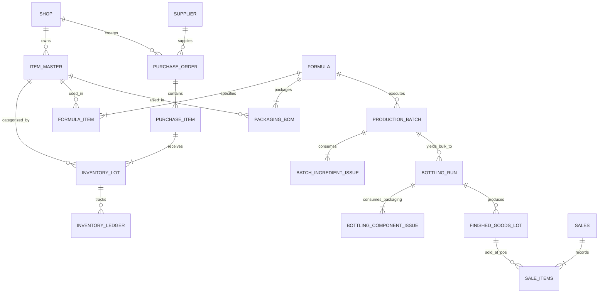

# TASK: Perfumery POS & Manufacturing Inventory Extension

> **Project:** Mahatir Perfumes (EdgeX POS Multi-Tenant Extension)  
> **Source Brief:** `Downloads/Perfumery POS Developer Brief.docx`  
> **Core Architectural Principle:**  
> 1. **Dual Operating Mode (Superadmin Configured):**  
>    - **Retail Seller (Default):** Standard ready-made product purchasing and POS billing. Purchases directly increment finished goods stock. Clean, uncluttered interface without formulation or blending overhead.  
>    - **Perfumery Manufacturer (Optional):** Full manufacturing module enabled. Purchases raw materials (oils, aroma chemicals, fixatives, solvents) and packaging components (bottles, pumps, caps, boxes) into lot-tracked inventory. Formulations define recipes (% BOM); blending produces Bulk Liquid (WIP); bottling runs package bulk liquid into Finished Goods with precise landed unit costs.  
> 2. **Zero-Regression Guarantee:** Existing POS checkout, customer/supplier ledgers, payment modes, and billing remain 100% backward-compatible.

---

## 1. Operating Model Overview

| Capability | Standard Retail Seller (Default) | Perfumery Manufacturer (Optional) |
| :--- | :--- | :--- |
| **Target User** | Retail shops, reseller kiosks, perfume stockists | In-house perfume blending labs & perfume brands |
| **Configured In** | Default for all shops | Enabled by Superadmin in Shop Management |
| **Purchasing Flow** | Purchases ready-made finished bottles directly $\to$ increases shelf stock | Purchases raw oils, chemicals, bottles, caps $\to$ receives into lot-tracked raw stock |
| **Inventory Types** | Finished sellable products only | Raw Oils, Aroma Chemicals, Packaging, Bulk WIP, Finished Goods |
| **Formulation (BOM)** | *Hidden* | Master recipes with % w/w or % v/v concentration |
| **Blending & WIP** | *Hidden* | Production Batches consume raw lots $\to$ yield bulk liquid |
| **Bottling & Packaging**| *Hidden* | Bottling Runs consume bulk liquid + packaging $\to$ yield finished goods |
| **POS Sales** | Sells shelf products | Sells finished goods; raw materials are strictly isolated |
| **Sidebar Menu** | Standard clean POS menu | Unlocks "Manufacturing & Blending" section |

---

## 2. Superadmin Feature Flag & Configuration Architecture

### 2.1 Database Schema Extensions for `shops`
- `shops.business_mode TEXT DEFAULT 'retailer'` (Allowed values: `'retailer'`, `'manufacturer'`).
- `shops.features JSONB`: Includes `manufacturing: true | false`.
- Updated `get_shop_config(p_shop_id)` and `secure_login` RPCs to return:
  ```json
  {
    "business_mode": "manufacturer",
    "features": {
      "manufacturing": true,
      "formulas": true,
      "production": true,
      "bottling": true
    }
  }
  ```

### 2.2 Superadmin UI Controls
- **Shop Creation (`CreateShopModal.jsx`):**
  - Radio/Toggle selector:
    - 🔘 **Retail Seller (Default):** Standard POS with ready-made product purchasing.
    - 🔘 **Perfumery Manufacturer:** Enables Raw Materials, Packaging Lots, Formulas, Blending, and Bottling.
- **Shop Editing (`EditShopModal.jsx`):**
  - Ability to upgrade an existing retail shop to Manufacturer mode or toggle the Manufacturing module on/off dynamically.
- **Subscription Plan Template Support:**
  - Standard Plan (Default Retailer features).
  - Manufacturer / Industrial Plan (Includes `manufacturing: true`).

### 2.3 Shop Frontend Adaptivity (`featureGate.js` & `Layout.jsx`)
- Utility helper `isManufacturer()` / `hasFeature('manufacturing')`.
- Cached in `localStorage` under `shop_business_mode_${shopId}` to prevent layout flicker.
- Navigation dynamically hides/shows the **Manufacturing & Blending** menu group.

---

## 3. Data Architecture & Entity Relationship Design (Manufacturer Mode)



### Table Definitions

1. **`items` (Unified Item Master)**:
   - `id`, `shop_id`, `sku`, `name`, `item_type` (`raw_oil`, `raw_chemical`, `packaging`, `bulk_liquid`, `finished_good`, `consumable`), `base_unit` (`g`, `ml`, `pcs`), `density` (numeric, g/ml for mass-volume conversion), `cost_price`, `sale_price`, `min_stock_level`, `is_active`.
2. **`unit_conversions`**:
   - `id`, `shop_id`, `item_id`, `from_unit`, `to_unit`, `conversion_factor`.
3. **`inventory_lots` (Lot & Expiry Tracking)**:
   - `id`, `shop_id`, `item_id`, `lot_number`, `supplier_lot_number`, `supplier_id`, `received_date`, `expiry_date`, `initial_quantity`, `available_quantity`, `unit_cost`, `location_id`, `status` (`available`, `quarantined`, `exhausted`, `expired`).
4. **`inventory_ledger` (Immutable Movement Ledger)**:
   - `id`, `shop_id`, `item_id`, `lot_id`, `location_id`, `transaction_type` (`purchase_receipt`, `supplier_return`, `production_issue`, `bulk_output`, `bottling_issue`, `bottling_output`, `pos_sale`, `customer_return`, `adjustment_loss`, `reversal`), `quantity`, `base_unit`, `unit_cost`, `total_cost`, `reference_id`, `notes`, `user_id`, `created_at`.
5. **`formulas` (Master Recipes)**:
   - `id`, `shop_id`, `name`, `version`, `finished_item_id`, `target_volume_ml`, `calculation_basis` (`weight_percentage`, `volume_percentage`), `notes`, `is_approved`, `created_by`, `approved_by`.
6. **`formula_ingredients`**:
   - `id`, `formula_id`, `ingredient_item_id`, `percentage`, `target_quantity`, `unit`, `tolerance_percent`.
7. **`formula_packaging_boms`**:
   - `id`, `formula_id`, `finished_variant_id`, `component_item_id`, `quantity_per_unit`.
8. **`production_batches` (Blending & Maceration)**:
   - `id`, `batch_number` (`MP-YYYYMMDD-###`), `shop_id`, `formula_id`, `planned_volume_ml`, `actual_volume_ml`, `status` (`draft`, `in_blending`, `maturing`, `completed`, `cancelled`), `started_at`, `completed_at`, `operator_id`, `total_material_cost`, `cost_per_ml`, `qc_status`, `qc_notes`.
9. **`batch_ingredient_issues`**:
   - `id`, `batch_id`, `ingredient_item_id`, `lot_id`, `planned_quantity`, `actual_quantity`, `unit`, `unit_cost`, `total_cost`.
10. **`bottling_runs`**:
    - `id`, `run_number`, `shop_id`, `source_batch_id`, `target_finished_item_id`, `fill_size_ml`, `planned_bottles`, `actual_good_bottles`, `rejected_bottles`, `bulk_consumed_ml`, `bulk_cost`, `packaging_cost`, `unit_cost`, `qc_status`, `operator_id`, `completed_at`.
11. **`bottling_component_issues`**:
    - `id`, `bottling_run_id`, `component_item_id`, `lot_id`, `quantity_used`, `quantity_damaged`, `unit_cost`.
12. **`inventory_locations`**:
    - `id`, `shop_id`, `name` (`Raw Material Store`, `Packaging Store`, `WIP Blending`, `Finished Goods Shelf`, `Quarantine`).

---

## 4. Phase-Wise Implementation Roadmap

### Phase 0: Superadmin Multi-Tenant Mode & Feature Gating
- [x] **0.1 Superadmin Schema Update**: Add `business_mode` (`retailer` | `manufacturer`) and `manufacturing` boolean feature flag to `shops` and `subscription_plans`.
- [x] **0.2 Superadmin UI Controls**:
  - Update `CreateShopModal.jsx` (both root and `superadmin/`) with "Business Mode" selector (Default: Retailer).
  - Update `EditShopModal.jsx` with mode toggle and manufacturing feature enablement.
- [x] **0.3 Shop Feature Gating Utility**: Update `featureGate.js` and `Layout.jsx` to conditionally render manufacturing navigation links only for manufacturer shops.

### Phase 1: Data Architecture, Master Classifications & Units
- [x] **1.1 Migration & Schemas**: Create tables for `items`, `inventory_lots`, `inventory_ledger`, and `inventory_locations`.
- [x] **1.2 Item Classification UI**: Enhance Products / Master Data with item types (`Raw Material / Oil`, `Chemicals / Solvents`, `Packaging`, `Finished Goods`).
- [x] **1.3 Unit of Measure & Density Engine**: Support multi-unit measuring (`g`, `kg`, `mL`, `L`, `pcs`) with density-based conversion (`mass = volume × density`).
- [x] **1.4 Dexie Schema Update**: Add new manufacturing and lot tables to local Dexie database for offline viewing.

### Phase 2: Purchasing Dual-Flow (Retail Ready-Made vs Manufacturer Raw)
- [x] **2.1 Retailer Flow Preservation (Default)**: Keep existing ready-made product purchasing intact for retail shops.
- [x] **2.2 Manufacturer Purchasing Screen**: For manufacturers, introduce raw ingredients & packaging purchasing UI with lot assignment.
- [x] **2.3 Lot Generation on Receiving**: Generate or record supplier lot/batch numbers upon goods receipt.
- [x] **2.4 Landed Costing & Unit Costs**: Calculate exact landed cost per gram / mL / piece (including freight allocation).
- [x] **2.5 Ledger Integration**: Confirmed raw purchases log `purchase_receipt` ledger entries and populate `inventory_lots` (leaving finished shelf stock untouched).

### Phase 3: Formula & Recipe Management (Manufacturer Mode Only)
- [x] **3.1 Formula Builder UI**: Dedicated page under navigation: `/formulas` (accessible only when `isManufacturer()` is true).
- [x] **3.2 Formula Composition**:
  - Blending proportions (% w/w or % v/v).
  - Ingredient line items with auto-calculated ratios.
  - Packaging BOM definition (bottle, cap, sprayer, box per size variant).
- [x] **3.3 Batch Scaling Calculator**: Enter target batch size (e.g., 500g or 2.5 Litres); automatically calculate required grams/mL of each oil and chemical.
- [x] **3.4 Recipe Versioning & Security**: Enforce version history (`v1.0`, `v1.1`) and role-based formula approval.

### Phase 4: Production & Blending Batches (Manufacturer Mode Only)
- [x] **4.1 Production Batches Screen**: Interface under `/production` with states (`Draft`, `In Progress`, `Maturing`, `Completed`).
- [x] **4.2 Ingredient Availability & Lot Picking**:
  - Show live stock of required oils and solvents.
  - Recommend oldest valid lots first (FIFO / FEFO).
  - Block batch posting if ingredients are insufficient.
- [x] **4.3 Batch Posting & Consumption**:
  - Record actual weighed quantities of oils and alcohol.
  - Deduct issued quantities from specific `inventory_lots`.
  - Record usable bulk liquid yield (mL), wastage, and calculate total blended bulk cost.
- [x] **4.4 Printable Batch Sheet**: Standardized printable batch worksheet for laboratory/workbench use.

### Phase 5: Bottling Runs & Finished Goods Creation (Manufacturer Mode Only)
- [x] **5.1 Bottling Run Screen**: Interface under `/bottling`.
- [x] **5.2 Link to Bulk Batch**: Select bulk perfume batch, target bottle size (e.g., 30ml, 50ml), and bottle count.
- [x] **5.3 Packaging Component Deduction**:
  - Consume matching bottles, sprayers, caps, and boxes.
  - Track broken/rejected packaging components.
- [x] **5.4 Finished Goods Lot Creation**:
  - Create finished sellable product lot with calculated unit cost:
    $$\text{Unit Cost} = \frac{\text{Bulk Liquid Consumed Cost} + \text{Packaging Components Cost}}{\text{Good Finished Units}}$$
  - Finished goods inventory increases **only** after QC sign-off.
- [x] **5.5 Printable Bottling Sheet**: Workbench bottling sheet with operator sign-off.

### Phase 6: POS Integration, Traceability & Analytics
- [x] **6.1 POS Sellable Stock Safeguards**:
  - POS displays only sellable finished products.
  - Block negative finished stock by default.
  - Never deduct raw ingredients on checkout.
- [x] **6.2 Returns & Quality Triage**:
  - Return workflow asks if returned item is sellable vs opened/damaged.
  - Opened/damaged returns transfer to Quarantine location, not available shelf stock.
- [x] **6.3 Full End-to-End Lot Traceability**:
  - Forward trace: Supplier Lot $\to$ Production Batch $\to$ Bottling Run $\to$ Customer Sales.
  - Backward trace: Sold Bottle $\to$ Bottling Run $\to$ Bulk Batch $\to$ Raw Oil Lots & Suppliers.
- [x] **6.4 Perfumery Analytics & Reports**:
  - Raw Material & Packaging Stock Valuation Report.
  - Batch Yield Variance & Waste Report.
  - Unit Cost Breakdown & Profit Margin Analysis.
  - Active Lots Overview & Inventory Expiry Management.

### Phase 7: Sidebar Redesign, Module Pinning & Executive Reporting Dashboard
- [x] **7.1 Themed Nav Section Styling**:
  - Distinct subtle background cards and colored borders for each functional domain:
    - ⚡ Core & Billing (Sky Blue)
    - 📦 Inventory & Catalog (Amber)
    - 👥 Sales & Customers (Emerald)
    - 🚚 Procurement (Indigo)
    - ⚗️ Manufacturing & Lab (Purple, manufacturer-gated)
    - 💼 Accounts & Admin (Rose)
    - ⚙️ Settings & System (Slate)
- [x] **7.2 Module Pinning / Quick Access Favorites**:
  - Interactive star toggle next to each navigation module.
  - Per-shop persistence in browser storage (`shop_favorites_${shopId}`).
  - Pinned modules dynamically render in a dedicated gold-accented "Favorites" tray at the top of the sidebar.
  - Seamless support for both expanded and collapsed/icon-only sidebar views.
- [x] **7.3 Executive Reporting Dashboard**:
  - Dynamic Timeframe Selector: **Today**, **7 Days**, **This Month**, and **YTD (Year)**.
  - Executive Financial KPI Grid: Net Sales, Gross Sales, Discounts, Gross Profit, Profit Margin %, Total Receivables (Udhaar), Low Stock Count.
  - Manufacturing KPIs (when `isManufacturer()` is true): Active Blending Batches, Macerating Bulk Liquid Volume (Litres), Bottled Units.
  - Interactive Visualizations (Recharts): Area Chart for sales/revenue timelines, Donut Chart for payment method distribution.
  - Actionable Operational Widgets: Live recent sales feed, Customer Receivables leaderboard with 1-click **WhatsApp Payment Reminders**, Low-stock alert cards with 1-click restock links, daily sales target tracker, and End-of-Day (EOD) Reconciliation modal with thermal printing and WhatsApp summary.

---

## 5. Acceptance Criteria & Validation Tests

1. **Default Retailer Shop Isolation**: Create a new shop with default settings (`retailer`). Confirm that Formulas, Production, and Bottling links are hidden. Confirm purchasing ready-made goods directly updates product stock.
2. **Superadmin Toggle Test**: In Superadmin, switch the shop mode from `retailer` to `manufacturer`. Refresh shop; verify that the "Manufacturing & Blending" section appears immediately.
3. **Receipt Verification (Manufacturer)**: Receive 1 kg of Oud Oil, 5 Litres of Alcohol, and 100 Glass Bottles. Verify that raw inventory increases, but Finished Perfumes stock remains strictly 0.
4. **Formula Scaling Verification**: Create a 20% concentration formula for "Reshmi". Scale to a 2,500 mL batch. Verify target ingredient calculations match exact percentages.
5. **Stock Depletion Safeguard**: Attempt to start a batch requiring 500g of oil when only 300g is in stock. System must block creation with an insufficient stock warning.
6. **Production Posting**: Post batch MP-001 with 400g oil and 1,600g alcohol. Verify exact ingredient lots are deducted, raw stock decreases, and a 2,000 mL bulk liquid WIP record is created.
7. **Bottling & Finished Goods**: Bottle 20 × 50mL bottles from batch MP-001. Verify 1,000 mL of bulk liquid and 20 sets of bottles/caps/sprayers are deducted. Verify finished sellable stock of "Reshmi 50mL" increases by exactly 20.
8. **POS Checkout Isolation**: Sell 1 bottle of "Reshmi 50mL" at POS. Verify finished stock decreases to 19. Verify raw oil, alcohol, and bottle components are **not** deducted again.
9. **Traceability Audit**: Open finished lot of "Reshmi 50mL". Trace back to batch MP-001, formula version, exact supplier lots, and supplier invoices.
10. **Sidebar Favorites & Navigation UX**: Click the star icon on any navigation item. Verify it appears in the top "Favorites" tray immediately and remains pinned across page reloads.
11. **Executive Dashboard & EOD Reconciliation**: Switch timeframes between Today, 7 Days, Month, and Year; verify KPI cards update dynamically. Open EOD Reconciliation modal and verify totals balance.

---

## 6. Implementation Status Tracker

| Phase | Description | Status | Target Delivery |
| :--- | :--- | :---: | :---: |
| **Phase 0** | Superadmin Multi-Tenant Mode & Feature Gating | `Completed ✅` | Day 1 |
| **Phase 1** | Schema, Unified Item Master, Units & Density | `Completed ✅` | Week 1 |
| **Phase 2** | Raw Material & Packaging Purchasing & Receiving | `Completed ✅` | Week 2 |
| **Phase 3** | Formula Management & Scaling Engine | `Completed ✅` | Week 3 |
| **Phase 4** | Blending & Production Batches | `Completed ✅` | Week 4 |
| **Phase 5** | Bottling Runs & Finished Goods QC Release | `Completed ✅` | Week 5 |
| **Phase 6** | POS Checkout Guardrails, Traceability & Analytics | `Completed ✅` | Week 6 |
| **Phase 7** | Sidebar Redesign, Module Pinning & Executive Dashboard | `Completed ✅` | Immediate |
